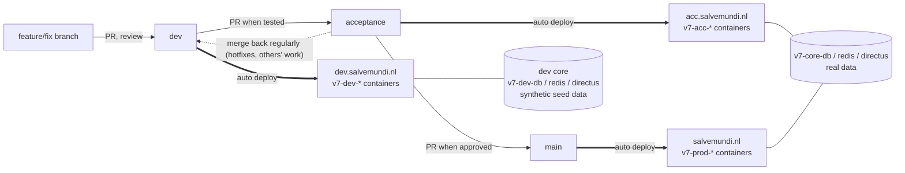
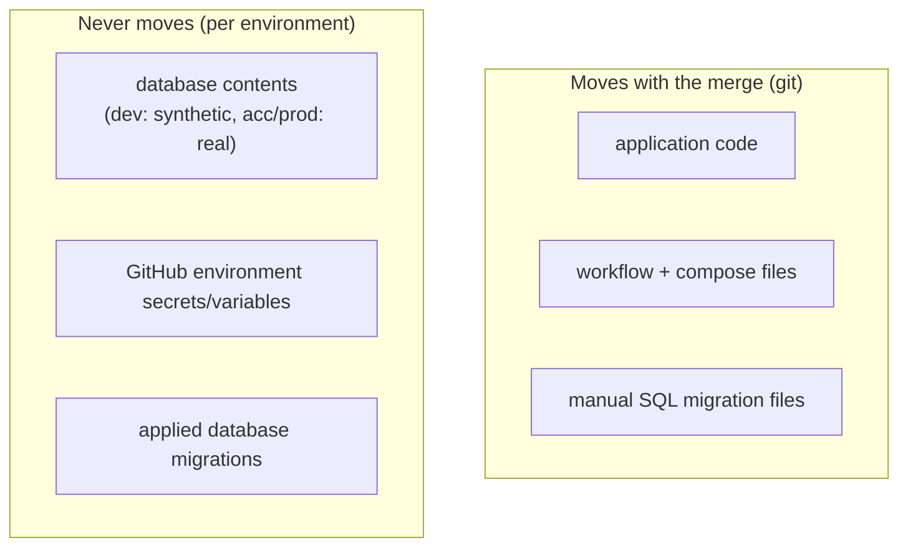

# Dev environment (`dev.salvemundi.nl`)

A permanent test environment next to acceptance and production on the V7 server, deployed from the `dev` branch.
It has its **own** Postgres, Redis and Directus ("dev core", `infrastructure/dev-server/docker-compose.yml`), with
synthetic seed data only. Acceptance and production share `v7-core-*`; dev never touches those containers.

> Not to be confused with `infrastructure/dev/`: that one starts a database on **your own PC** for local development
> (`pnpm dev:infra`). This folder, `infrastructure/dev-server/`, is the **server** environment dev.salvemundi.nl.

| | Acceptance | Dev |
|---|---|---|
| Branch | `acceptance` | `dev` |
| GitHub environment | Acceptance | **Development** |
| URL | acc.salvemundi.nl | dev.salvemundi.nl |
| Database / Redis / Directus | `v7-core-*` (shared with production) | `v7-dev-db`, `v7-dev-redis`, `v7-dev-directus` |
| App containers | `v7-acc-*` (port 3000) | `v7-dev-*` (port 5000, services 2300x) |
| Data | real | synthetic seed (`packages/db/dev/seed-data.mjs`) |
| Mobile API | `MOBILE_API_ENABLED` | `MOBILE_API_ENABLED` (same gate) |
| Azure sync / provisioning jobs | off | off (never touches real Microsoft accounts) |
| Payments | Mollie test simulator | Mollie test simulator (use a **test** API key) |

## One-time setup

### 1. DNS and proxy
- DNS: `dev.salvemundi.nl` → the same address as `acc.salvemundi.nl`.
- Nginx Proxy Manager: new proxy host `dev.salvemundi.nl` → `http://v7-dev-app:3000` (scheme http, websockets on),
  with a Let's Encrypt certificate and "Force SSL", like the acceptance host.

### 2. Microsoft Entra
In the website's app registration (`AZURE_WEBSITEV7_AUTH_CLIENT_ID`) add the redirect URI
`https://dev.salvemundi.nl/api/auth/callback/microsoft`. Use the same tenant; no new app registration is needed.

### 3. GitHub environment "Development"
Settings → Environments → New environment `Development`. Restrict deployments to the `dev` branch.

Secrets. Generate **new** values for everything marked *new*; never copy production or acceptance database credentials:

| Secret | Value |
|---|---|
| `DB_USER`, `DB_NAME` | e.g. `salvemundi_dev` |
| `DB_PASSWORD` | *new*, long random |
| `DB_PORT` | `5432` |
| `REDIS_PASSWORD` | *new*, long random |
| `DIRECTUS_KEY`, `DIRECTUS_SECRET` | *new*, random (UUID / 32+ chars) |
| `DIRECTUS_STATIC_TOKEN` | *new*, random (the seed and website use it) |
| `DIRECTUS_ADMIN_EMAIL`, `DIRECTUS_ADMIN_PASSWORD` | *new*: local admin of the dev Directus |
| `BETTER_AUTH_SECRET`, `INTERNAL_SERVICE_TOKEN` | *new*, random |
| `MOLLIE_API_KEY` | a Mollie **test** key (`test_…`) |
| `MOLLIE_WEBHOOK_SECRET` | *new*, random |
| `AZURE_WEBSITEV7_TENANT_ID`, `AZURE_WEBSITEV7_AUTH_CLIENT_ID`, `AZURE_WEBSITEV7_AUTH_CLIENT_SECRET` | same as acceptance (login) |
| `SSH_KEY`, `SSH_USER`, `SSH_KNOWN_HOSTS`, `VPN_IP`, `NETBIRD_SETUP_KEY`, `NETBIRD_MANAGEMENT_URL` | same as acceptance (deployment) |
| Other secrets the stack reads (mail, sync, management, Kuma, Discord, Google, Minecraft) | optional; leave empty unless you test those features. Sync/provisioning jobs are off in dev anyway. |

Variables:

| Variable | Value |
|---|---|
| `PUBLIC_URL`, `BETTER_AUTH_URL` | `https://dev.salvemundi.nl` |
| `MOBILE_API_ENABLED` | `true` |
| `MOBILE_ANDROID_SHA256_CERT_FINGERPRINTS` | optional, for Android App Links on dev |
| `MOBILE_APPLE_TEAM_ID` | optional, for iOS universal links on dev |
| `DEV_DB_PORT`, `DEV_DIRECTUS_PORT` | optional; default `5433` / `8056` (VPN-only ports on the server) |

### 4. Branch and first deploy
1. Push the `dev` branch, or run **Deploy V7 Stack** manually on `dev` with `mobile_setup_action` set to `none`.
   The workflow starts the dev core and app containers.
2. For a fresh database, initialize the schema and load synthetic data using the [database setup scripts](../../README.md)
   against the dev database. Apply any mobile SQL migrations in `packages/db/drizzle/` that the dev app needs.
3. Add a test member whose email matches your Microsoft account before signing in at `https://dev.salvemundi.nl`.
   Dev has no Azure sync, and website login requires an existing member.

## Day to day

- Pushing to `dev` runs the dev deployment. The Actions summary shows which images were built or reused and which app
  containers were created, reused, or recreated.
- To inspect logs from the VPS, use `docker logs --tail 150 v7-dev-app` or substitute the dev container you need.
- The Android app against dev: build with `-Psalvemundi.apiBaseUrl=https://dev.salvemundi.nl`.
- Start over completely (on the server, deletes all dev data):
  `cd /opt/salve-mundi-v7/dev-core && docker compose -p v7-dev-core --env-file .env.dev-core down -v`

## Branch flow: from dev to acceptance to production

1. **Feature branch → `dev`.** Work on a branch from `dev` (or from `acceptance`) and open a PR into `dev`. Merging deploys
   to dev.salvemundi.nl, where you can test freely: website, mobile API, app login, payments with the Mollie simulator.
2. **`dev` → `acceptance`.** When it works on dev, open a PR from `dev` into `acceptance`. Merging deploys acceptance.
3. **`acceptance` → `main`.** As before: production is promoted from acceptance.
4. **Keep dev current.** Others keep merging into `acceptance`; merge `acceptance` back into `dev` regularly so dev tests
   what will actually ship, and so the PR into acceptance stays small and conflict-free.

### What a merge moves, and what it doesn't

- **Code** goes to acceptance exactly as reviewed. The dev-only parts are switched off there by environment:
  - The dev core starts only on `dev`, where the stack runs without Wie is de Mol.
  - Acceptance and production keep deploying exactly as before: same ports and `v7-core-*` hosts, all services.
    The `DB_HOST` default and `CORE_PREFIX` both resolve to `v7-core-*` outside dev.
  - The `ENV_NAME === 'dev'` checks (feature flags, Azure sync off, manual payment approval, mobile gate) change
    nothing for `acc` or `prod`. Production stays excluded from the mobile API.
- **Data never moves.** Nothing you create on dev (activities, registrations, test members) reaches acceptance, and
  real acceptance/production data never reaches dev. Dev only has its own synthetic seed.
- **Database schema changes do not apply themselves.** The website has no automatic migrations: manual SQL files in
  `packages/db/drizzle/` must be run against each environment's database separately. Acceptance and production share `v7-core-db`. Apply additive
  migrations to acceptance **before** merging code that writes the new columns.
- **Secrets and variables are per GitHub environment.** A feature that needs a new secret or variable must get it in
  *Acceptance* (and later *Production*) too; the dev values don't carry over.

### Checklist before merging `dev` into `acceptance`
1. `acceptance` is merged into `dev` and dev still works (no conflicts left for the PR).
2. The PR's CI is green (lint, type check, mobile tests).
3. Every new manual SQL migration is applied to the acceptance database (see below for the current one).
4. New secrets/variables exist in the *Acceptance* environment.
5. Only intended commits are in the PR: dev is a shared test branch, so drop experiments that shouldn't ship.

### Current state of `dev` (Android support + dev environment)
Merging the current `dev` into `acceptance` is safe; it merges cleanly and the acceptance deploy is unchanged. Notes:
- **iOS app:** keeps working as is; device registration without the new `platform` column is unchanged.
- **Android device registration** (push) on acceptance needs `packages/db/drizzle/mobile_notifications_android.sql`
  applied to the acceptance database first; until then Android push registration fails there. It is additive and
  idempotent, and it only alters the `mobile_*` tables.
- **Android App Links** on acceptance need the Acceptance variable `MOBILE_ANDROID_SHA256_CERT_FINGERPRINTS`.
- **Android push delivery** stays off until the FCM worker settings are configured (`apps/mobile/docs/mobile-android.md`).

## Resources
The dev core adds about 1.5 GB of memory limits (Postgres 512 MB, Redis 256 MB, Directus 768 MB) plus the `v7-dev-*`
app containers. Check the server's free memory before the first deploy.
